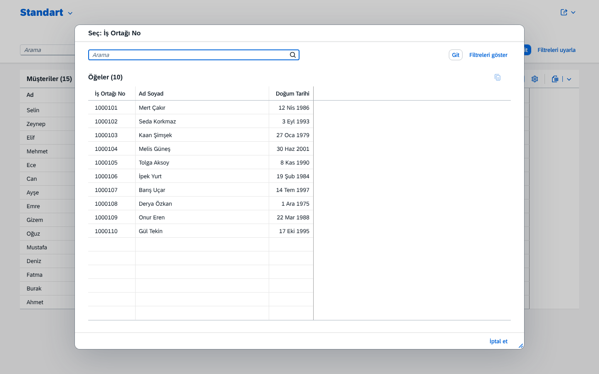
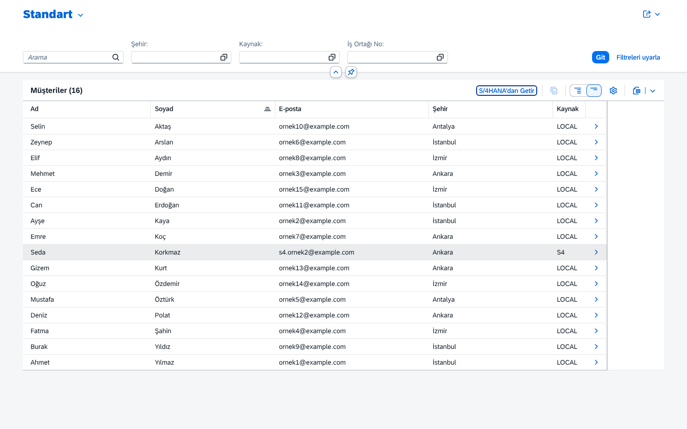
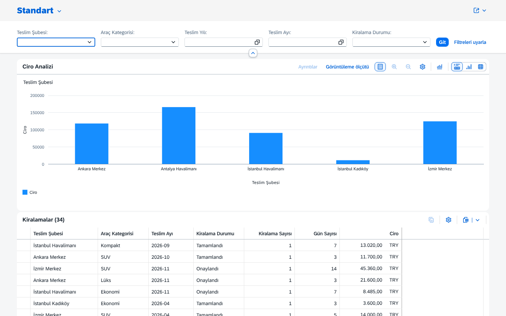
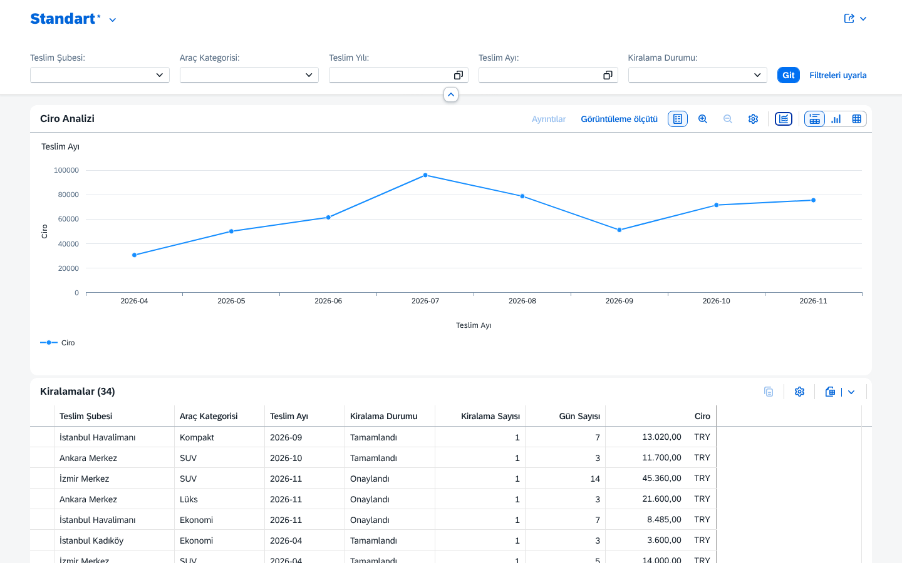

# RentACar — SAP CAP ile Araç Kiralama

Birden fazla şubesi olan bir araç kiralama firması için SAP Cloud Application Programming Model (CAP, Node.js)
ile geliştirilen uygulama. Şube çalışanları kiralama kaydı oluşturur, yöneticiler onaylar veya reddeder,
araç geri geldiğinde kiralama tamamlanır.

Mimari, SAP'nin resmi örneği [SAP-samples/cap-sflight](https://github.com/SAP-samples/cap-sflight)'tan esinlenmiştir.

| Kiralama listesi | Kiralama detayı (yönetici) |
|---|---|
|  |  |
| **Taslakta ek hizmet, anlık fiyat** | **Kaydet'te iş kuralı hataları** |
|  |  |
| **Araç value help (sadece müsait)** | **Filo yönetimi** |
|  |  |
| **S/4HANA'dan Getir: iş ortağı seçimi** | **İçe aktarılan müşteri (Kaynak = S4)** |
|  |  |
| **Kiralama analizi: şube bazında ciro** | **Aylık trend** |
|  |  |

Diğer ekranlar: [agent görünümü](docs/img/03-kiralama-detay-agent.png) · [km hatası](docs/img/06-tamamla-km-hatasi.png) ·
[launchpad](docs/img/09-launchpad.png) · [İngilizce liste](docs/img/10-kiralama-listesi-en.png) ·
[S/4 kurum hatası](docs/img/13-s4-kurum-hatasi.png)

## Gereksinimler

- Node.js 22 veya üzeri (LTS)
- Docker Desktop (lokal PostgreSQL için)

## Kurulum (PowerShell)

```powershell
npm ci                              # bağımlılıkları kur
Copy-Item .env.example .env         # lokal bağlantı ayarları (gerekirse düzenle)
npm run db:up                       # PostgreSQL container'ını başlat
npm run db:deploy                   # şemayı ve örnek verileri yükle
npm run watch                       # http://localhost:4004
```

Tarayıcıda <http://localhost:4004> **Fiori Launchpad**'i açar (kullanıcı/şifre sorar, bkz. Test kullanıcıları).
Dil için adrese `?sap-language=tr` veya `?sap-language=en` ekle.

| Uygulama | Adres |
|---|---|
| Launchpad | http://localhost:4004/?sap-language=tr |
| Kiralama Yönetimi | http://localhost:4004/rentals/webapp/index.html?sap-language=tr |
| Filo Yönetimi | http://localhost:4004/vehicles/webapp/index.html?sap-language=tr |
| Müşteriler (S/4HANA'dan Getir) | http://localhost:4004/customers/webapp/index.html?sap-language=tr |
| Kiralama Analizi (sadece manager) | http://localhost:4004/analytics/webapp/index.html?sap-language=tr |

> Model (`.cds`) değiştiğinde `npm run db:deploy` çalıştır; `cds watch` PostgreSQL şemasını kendisi güncellemez.
> `npm run db:reset` sonrası `cds watch`'ı yeniden başlat (veritabanı bağlantıları kopar).

Veritabanını sıfırlamak için: `npm run db:reset`. Durdurmak için: `npm run db:down`.

## S/4HANA entegrasyonu

Müşteriler S/4HANA'nın Business Partner API'sinden içe aktarılabilir. Üç mod vardır, kod değişmez:

| Mod | Komut | S/4 verisi |
|---|---|---|
| Mock (varsayılan) | `npm run watch` | `srv/external/data/*.csv` (10 kişi, 2 kurum); internet gerekmez |
| SAP sandbox | `npm run sandbox` | `sandbox.api.sap.com`; `.env`'de `BP_API_KEY` gerekir |
| Production | BTP Destination `API_BUSINESS_PARTNER` ([`docs/deploy.md`](docs/deploy.md)) | Sandbox veya gerçek S/4HANA |

Sandbox için api.sap.com'dan aldığın anahtarı **sadece** `.env` dosyasına yaz (`BP_API_KEY=...`). `.env`'i asla
commit'leme veya GitHub web arayüzüyle yükleme. Ayrıntı: [`docs/s4-entegrasyonu.md`](docs/s4-entegrasyonu.md).

## BTP'ye deploy (SAP HANA Cloud)

Proje SAP BTP Cloud Foundry + SAP HANA Cloud için hazır. Paket üretmek için `npm install -g mbt` ve GNU Make gerekir:

```powershell
mbt build                                     # → mta_archives\rentacar_1.0.0.mtar
cf deploy mta_archives\rentacar_1.0.0.mtar    # cf login sonrası
```

Trial hesabı, HANA Cloud instance'ı, S/4 destination'ı ve rol atamaları dahil tüm adımlar:
[`docs/deploy.md`](docs/deploy.md).

## Testler

```powershell
npm test            # 117 entegrasyon + birim testi, bellek içi SQLite (Docker gerekmez)
npm run test:pg     # aynı testler PostgreSQL'e karşı (ayrı rentacar_test veritabanı; önce npm run db:up)
npm test -- --grep K2   # sadece adında "K2" geçen testler
```

Kapsam: K1–K8 iş kuralları (başarılı ve hatalı durumlar), 5 action'ın ön koşulları, yetki (401/403), fiyat
senaryoları (1/7/14 gün, farklı şube, ek hizmet), draft akışı, ana veri silme koruması, S/4HANA okuma ve içe
aktarma (mock modunda; internet ve API anahtarı gerekmez), analitik toplamlar (`$apply`). Ayrıntı ve SQLite–PostgreSQL farkları:
[`docs/ogrenme-notlari/07-testler.md`](docs/ogrenme-notlari/07-testler.md).

## Servisler

| Servis | URL | İçerik |
|---|---|---|
| `RentalService` | http://localhost:4004/rental | Kiralamalar (draft), müşteriler, value help verileri, S/4 iş ortakları (`S4BusinessPartners`), `importFromS4` |
| `AnalyticsService` | http://localhost:4004/analytics | Kiralama analizi (`$apply`): şube bazında ciro, kategori bazında kiralama sayısı, aylık trend |
| `AdminService` | http://localhost:4004/admin | Araçlar (draft), şubeler, ek hizmetler, kategoriler |

Örnek istekler: [`test/requests.http`](test/requests.http) (VS Code REST Client eklentisi).
İş kuralları ve action'lar: [`docs/is-kurallari.md`](docs/is-kurallari.md).

## Veritabanı profilleri

| Profil | Veritabanı | Ne zaman |
|---|---|---|
| `development` (varsayılan) | PostgreSQL 16 (Docker) | `cds watch`, `cds deploy` |
| `test` | SQLite, bellek içi | `npm test` |
| `production` | SAP HANA Cloud (HDI) | BTP'de; kimlik doğrulama XSUAA ([`docs/deploy.md`](docs/deploy.md)) |
| `sandbox` (ek profil) | PostgreSQL (development ile birlikte) | `npm run sandbox`: S/4 olarak SAP sandbox'ı kullanılır |

## Proje yapısı

| Klasör / Dosya | Amaç |
|---|---|
| `db/` | Veri modeli: `schema.cds` (kiralama), `master-data.cds` (ana veriler), `labels.cds` (etiketler), `data/*.csv` |
| `srv/` | `rental-service.cds/.js` (kiralama, iş kuralları, S/4 entegrasyonu), `analytics-service.cds/.js` (analitik), `admin-service.cds/.js` (filo, silme koruması), `field-control.cds`, `auth.cds` (yetkiler) |
| `srv/external/` | S/4HANA Business Partner API modeli (`cds import`) ve mock verileri (`data/*.csv`) |
| `app/` | Fiori Elements uygulamaları (`rentals`, `vehicles`, `customers`, `analytics`), ortak anotasyonlar (`common.cds`), launchpad (`index.html`) |
| `_i18n/` | Arayüz metinleri (`i18n*.properties`) ve hata mesajları (`messages*.properties`) |
| `test/` | Otomatik testler (`*.test.js`, Mocha + `@cap-js/cds-test`), `requests.http` örnek istekleri |
| `xs-security.json` | BTP XSUAA: roller ve rol koleksiyonları |
| `mta.yaml` | BTP paketi: CAP servisi, HANA HDI deployer, approuter; XSUAA, HDI container, Destination servisleri |
| `.deploy/app-router/` | Approuter (`xs-app.json`: arayüzü sunar, OData'yı CAP'e iletir) |
| `scripts/copy-ui.mjs` | `mbt build` sırasında Fiori uygulamalarını approuter'a kopyalar (`npm run build:ui`) |
| `docs/` | Mimari, iş kuralları, CAP–RAP karşılaştırması, sözlük, öğrenme notları |
| `docker-compose.yml` | Lokal PostgreSQL |
| `.env.example` | Lokal ortam değişkenleri şablonu (`.env` commit edilmez) |

## Test kullanıcıları

Lokalde CAP'in `mocked` kimlik doğrulaması kullanılır (tarayıcı kullanıcı adı/şifre sorar):

| Kullanıcı / şifre | Roller | Yapabilecekleri |
|---|---|---|
| `agent` / `agent` | RentalAgent | Kiralama oluşturma/düzenleme, müşteri ekleme, S/4'ten müşteri getirme, tamamlama, iptal |
| `manager` / `manager` | RentalAgent, RentalManager | Agent'ın her şeyi + onaylama, reddetme, indirim, kiralama analizi |
| `admin` / `admin` | FleetAdmin | Sadece filo yönetimi (AdminService) |

Ayrıntılı yetki tablosu: [`docs/mimari.md`](docs/mimari.md#yetkilendirme). BTP için taslak: `xs-security.json`.

## Sorun giderme

| Belirti | Sebep | Çözüm |
|---|---|---|
| `npm run db:up`: "Cannot connect to the Docker daemon" / "error during connect" | Docker Desktop çalışmıyor | Docker Desktop'ı başlat, sonra tekrar `npm run db:up` |
| `npm run db:up`: "port is already allocated" | Bilgisayarda 5432'yi kullanan başka bir PostgreSQL var | `.env`'de `CDS_REQUIRES_DB_CREDENTIALS_PORT=5433` yap, `npm run db:up` |
| "password authentication failed" | `.env` yok veya şifre farklı | `Copy-Item .env.example .env` |
| İstekte "column ... does not exist" | Model değişti, veritabanı eski | `npm run db:deploy` (gerekirse `npm run db:reset`) |
| `cds watch` `db:reset` sonrası "server shutdown" ile kapandı | Container yeniden kurulurken açık bağlantılar koptu | `npm run watch`'ı yeniden başlat |
| Arayüz boş kalıyor veya yüklenmiyor | UI5, `ui5.sap.com`'dan yüklenir; internet veya kurumsal proxy engeli | `https://ui5.sap.com/1.153.0/resources/sap-ui-version.json` tarayıcıda açılıyor mu bak |
| Kutucuğa tıklayınca "Uygulama, uygulamanın SAP UI5 bileşeni yüklenemediğinden açılamadı" | Giriş yapılmadı; tarayıcı kullanıcı adı/şifre penceresini açmadı (ayrıntıda "Unauthorized") | Yeni sekmede http://localhost:4004/rental/ aç, `agent`/`agent` ile gir, sonra launchpad'i yenile |
| Hep aynı kullanıcıyla giriliyor | Tarayıcı Basic Auth bilgisini hatırlar | Başka kullanıcı için gizli pencere aç |
| `npm run test:pg`: "ECONNREFUSED" | PostgreSQL ayakta değil | `npm run db:up` |
| S/4'ten Getir: "S/4HANA erişimi reddedildi (401/403)" | `BP_API_KEY` yok, yanlış veya yenilenmiş | `.env`'deki anahtarı kontrol et, `npm run sandbox`'ı yeniden başlat |
| S/4'ten Getir: "S/4HANA sistemine şu anda ulaşılamıyor" | İnternet/proxy engeli veya sandbox 10 sn'de yanıt vermedi | `https://sandbox.api.sap.com` erişilebilir mi bak; mock modunda (`npm run watch`) çalış |
| S/4 iş ortakları açılmıyor: `relation "api_business_partner_..." does not exist` | Mock tabloları yüklenmedi | `npm run db:deploy` (`--with-mocks` ile S/4 mock tablolarını da kurar) |

## Kullanılan teknolojiler

| Paket | Sürüm |
|---|---|
| `@sap/cds` | 10.2.1 |
| `@sap/cds-dk` | 10.2.0 |
| `@cap-js/postgres` | 3.1.2 |
| `@cap-js/sqlite` | 3.1.2 |
| `@cap-js/hana` | 3.1.2 |
| `@sap/xssec` | 4.15.0 |
| `@sap/approuter` | 23 |
| Cloud MTA Build Tool (`mbt`) | 1.2.47 |
| PostgreSQL | 16 |
| SAPUI5 (CDN) | 1.153.0 |
| `@cap-js/cds-test` + Mocha | 1.0.2 + 12.0.3 |

## Yol haritası

| Aşama | Konu | Durum |
|---|---|---|
| 0 | Ortam ve iskelet (CAP, PostgreSQL, profiller) | ✅ |
| 1 | Veri modeli ve örnek veri | ✅ |
| 2 | Servisler | ✅ |
| 3 | İş mantığı (K1–K8, action'lar) | ✅ |
| 4 | Yetkilendirme | ✅ |
| 5 | Fiori Elements arayüzü | ✅ |
| 6 | Testler | ✅ |
| 7 | Dokümantasyon ve gözden geçirme | ✅ |
| 8 | S/4HANA Business Partner entegrasyonu | ✅ |
| 9 | (Opsiyonel) Analitik | ✅ |
| 10 | BTP deploy hazırlığı (SAP HANA Cloud) — deploy senin adımın: [`docs/deploy.md`](docs/deploy.md) | ✅ |

## Dokümanlar

| Doküman | İçerik |
|---|---|
| [Mimari](docs/mimari.md) | Katmanlar, veri modeli (ER diyagramı), istek akışı, yetki tablosu, testler |
| [İş kuralları](docs/is-kurallari.md) | K1–K8, action'lar, silme koruması; her kuralın kodda ve testte yeri |
| [CAP vs RAP](docs/cap-vs-rap.md) | Bu projedeki her yapının ABAP RAP karşılığı, hangisi ne zaman, RAP'i deneme yolları |
| [BTP'ye deploy](docs/deploy.md) | Trial hesabı, HANA Cloud, destination, `mbt build` + `cf deploy`, rol koleksiyonları, kontrol listesi, HDI ile PostgreSQL farkı |
| [S/4HANA entegrasyonu](docs/s4-entegrasyonu.md) | Mimari, mock/sandbox/destination modları, V2 → V4, hata yönetimi, Cloud Connector |
| [Sözlük](docs/sozluk.md) | SAP/CAP terimleri (Türkçe) |
| [Öğrenme notları](docs/ogrenme-notlari/README.md) | Her aşamanın kavramları, RAP karşılığı, sık hatalar ve alıştırmalar |
