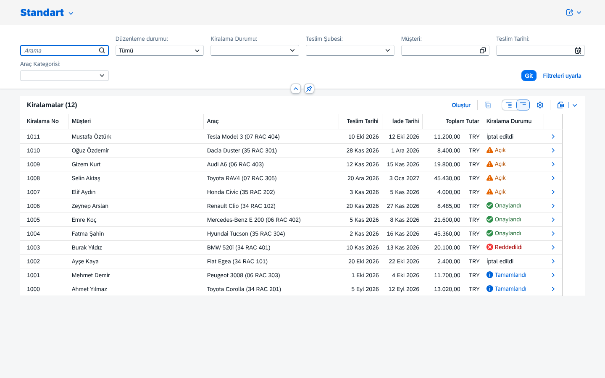
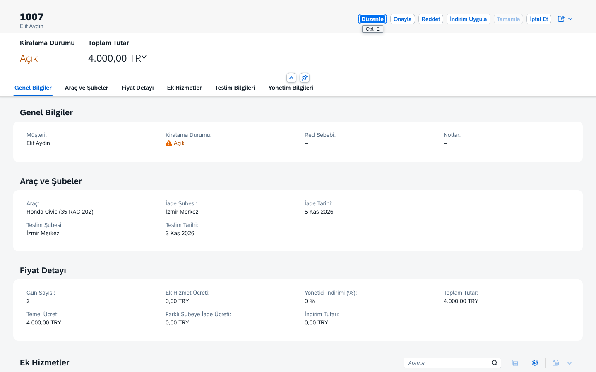
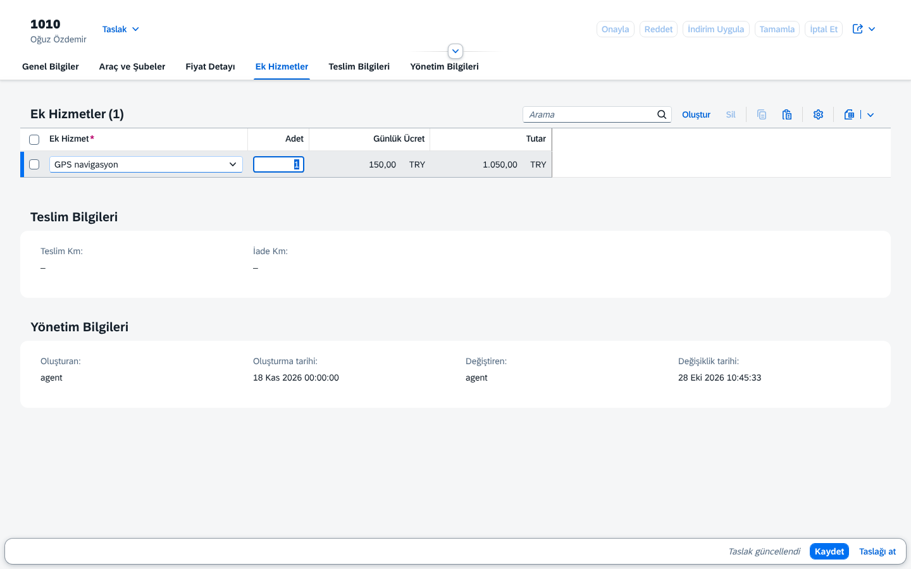
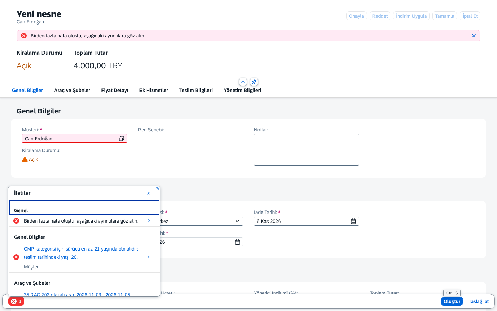
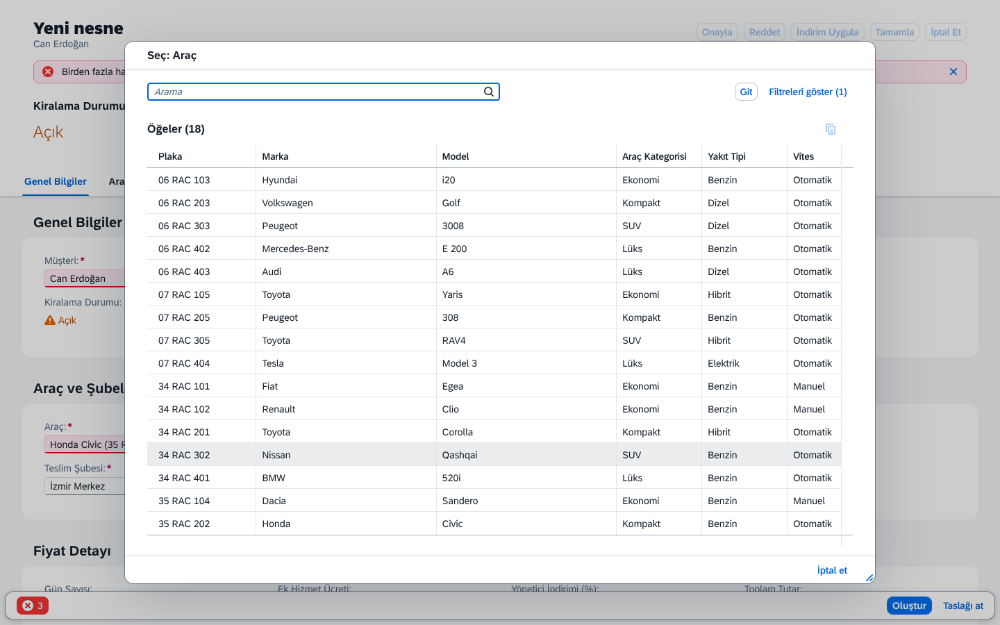
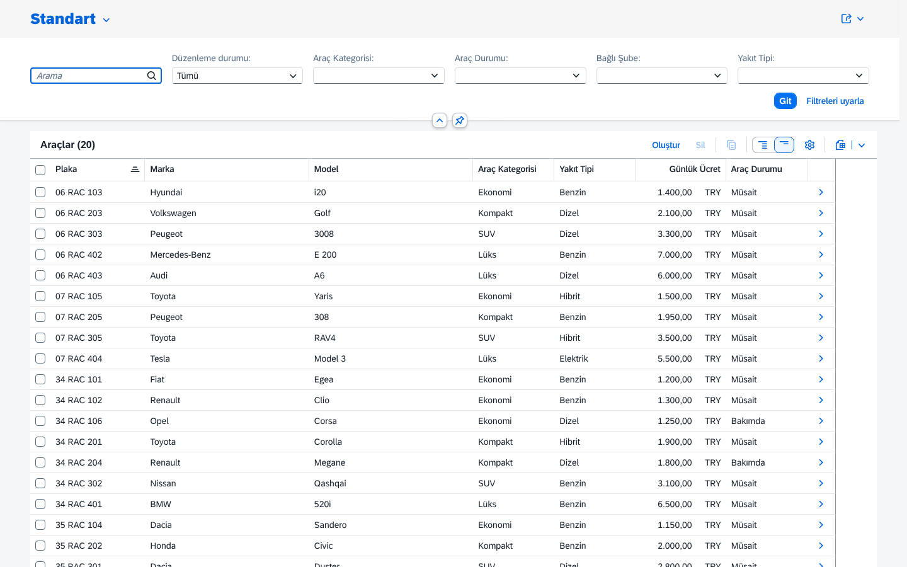

# RentACar — SAP CAP ile Araç Kiralama

Birden fazla şubesi olan bir araç kiralama firması için SAP Cloud Application Programming Model (CAP, Node.js)
ile geliştirilen uygulama. Şube çalışanları kiralama kaydı oluşturur, yöneticiler onaylar veya reddeder,
araç geri geldiğinde kiralama tamamlanır.

Mimari, SAP'nin resmi örneği [SAP-samples/cap-sflight](https://github.com/SAP-samples/cap-sflight)'tan esinlenmiştir.

| Kiralama listesi | Kiralama detayı (yönetici) |
|---|---|
|  |  |
| **Taslakta ek hizmet, anlık fiyat** | **Kaydet'te iş kuralı hataları** |
|  |  |
| **Araç value help (sadece müsait)** | **Filo yönetimi** |
|  |  |

Diğer ekranlar: [agent görünümü](docs/img/03-kiralama-detay-agent.png) · [km hatası](docs/img/06-tamamla-km-hatasi.png) ·
[launchpad](docs/img/09-launchpad.png) · [İngilizce liste](docs/img/10-kiralama-listesi-en.png)

## Gereksinimler

- Node.js 22 veya üzeri (LTS)
- Docker Desktop (lokal PostgreSQL için)

## Kurulum (PowerShell)

```powershell
npm ci                              # bağımlılıkları kur
Copy-Item .env.example .env         # lokal bağlantı ayarları (gerekirse düzenle)
npm run db:up                       # PostgreSQL container'ını başlat
npm run db:deploy                   # şemayı ve örnek verileri yükle
npm run watch                       # http://localhost:4004
```

Tarayıcıda <http://localhost:4004> **Fiori Launchpad**'i açar (kullanıcı/şifre sorar, bkz. Test kullanıcıları).
Dil için adrese `?sap-language=tr` veya `?sap-language=en` ekle.

| Uygulama | Adres |
|---|---|
| Launchpad | http://localhost:4004/?sap-language=tr |
| Kiralama Yönetimi | http://localhost:4004/rentals/webapp/index.html?sap-language=tr |
| Filo Yönetimi | http://localhost:4004/vehicles/webapp/index.html?sap-language=tr |

> Model (`.cds`) değiştiğinde `npm run db:deploy` çalıştır; `cds watch` PostgreSQL şemasını kendisi güncellemez.
> `npm run db:reset` sonrası `cds watch`'ı yeniden başlat (veritabanı bağlantıları kopar).

Veritabanını sıfırlamak için: `npm run db:reset`. Durdurmak için: `npm run db:down`.

## Testler

```powershell
npm test            # 86 entegrasyon + birim testi, bellek içi SQLite (Docker gerekmez)
npm run test:pg     # aynı testler PostgreSQL'e karşı (ayrı rentacar_test veritabanı; önce npm run db:up)
npm test -- --grep K2   # sadece adında "K2" geçen testler
```

Kapsam: K1–K8 iş kuralları (başarılı ve hatalı durumlar), 5 action'ın ön koşulları, yetki (401/403), fiyat
senaryoları (1/7/14 gün, farklı şube, ek hizmet), draft akışı. Ayrıntı ve SQLite–PostgreSQL farkları:
[`docs/ogrenme-notlari/07-testler.md`](docs/ogrenme-notlari/07-testler.md).

## Servisler

| Servis | URL | İçerik |
|---|---|---|
| `RentalService` | http://localhost:4004/rental | Kiralamalar (draft), müşteriler, value help verileri |
| `AdminService` | http://localhost:4004/admin | Araçlar (draft), şubeler, ek hizmetler, kategoriler |

Örnek istekler: [`test/requests.http`](test/requests.http) (VS Code REST Client eklentisi).
İş kuralları ve action'lar: [`docs/is-kurallari.md`](docs/is-kurallari.md).

## Veritabanı profilleri

| Profil | Veritabanı | Ne zaman |
|---|---|---|
| `development` (varsayılan) | PostgreSQL 16 (Docker) | `cds watch`, `cds deploy` |
| `test` | SQLite, bellek içi | `npm test` |
| `production` | SAP HANA Cloud | BTP deploy (Aşama 10) |

## Proje yapısı

| Klasör / Dosya | Amaç |
|---|---|
| `db/` | Veri modeli: `schema.cds` (kiralama), `master-data.cds` (ana veriler), `labels.cds` (etiketler), `data/*.csv` |
| `srv/` | `rental-service.cds` + `rental-service.js` (iş kuralları), `field-control.cds`, `admin-service.cds`, `auth.cds` (yetkiler) |
| `app/` | Fiori Elements uygulamaları (`rentals`, `vehicles`), ortak anotasyonlar (`common.cds`), launchpad (`index.html`) |
| `_i18n/` | Arayüz metinleri (`i18n*.properties`) ve hata mesajları (`messages*.properties`) |
| `test/` | Otomatik testler (`*.test.js`, Mocha + `@cap-js/cds-test`), `requests.http` örnek istekleri |
| `xs-security.json` | BTP XSUAA yetki yapılandırması taslağı (Aşama 10'da kullanılacak) |
| `docs/` | Mimari, iş kuralları, CAP–RAP karşılaştırması, sözlük, öğrenme notları |
| `docker-compose.yml` | Lokal PostgreSQL |
| `.env.example` | Lokal ortam değişkenleri şablonu (`.env` commit edilmez) |

## Test kullanıcıları

Lokalde CAP'in `mocked` kimlik doğrulaması kullanılır (tarayıcı kullanıcı adı/şifre sorar):

| Kullanıcı / şifre | Roller | Yapabilecekleri |
|---|---|---|
| `agent` / `agent` | RentalAgent | Kiralama oluşturma/düzenleme, müşteri ekleme, tamamlama, iptal |
| `manager` / `manager` | RentalAgent, RentalManager | Agent'ın her şeyi + onaylama, reddetme, indirim |
| `admin` / `admin` | FleetAdmin | Sadece filo yönetimi (AdminService) |

Ayrıntılı yetki tablosu: [`docs/mimari.md`](docs/mimari.md#yetkilendirme). BTP için taslak: `xs-security.json`.

## Kullanılan teknolojiler

| Paket | Sürüm |
|---|---|
| `@sap/cds` | 10.2.1 |
| `@sap/cds-dk` | 10.2.0 |
| `@cap-js/postgres` | 3.1.2 |
| `@cap-js/sqlite` | 3.1.2 |
| PostgreSQL | 16 |
| SAPUI5 (CDN) | 1.153.0 |
| `@cap-js/cds-test` + Mocha | 1.0.2 + 12.0.3 |

## Yol haritası

| Aşama | Konu | Durum |
|---|---|---|
| 0 | Ortam ve iskelet (CAP, PostgreSQL, profiller) | ✅ |
| 1 | Veri modeli ve örnek veri | ✅ |
| 2 | Servisler | ✅ |
| 3 | İş mantığı (K1–K8, action'lar) | ✅ |
| 4 | Yetkilendirme | ✅ |
| 5 | Fiori Elements arayüzü | ✅ |
| 6 | Testler | ✅ |
| 7 | Dokümantasyon ve gözden geçirme | ⏳ |
| 8 | S/4HANA Business Partner entegrasyonu | |
| 9 | (Opsiyonel) Analitik | |
| 10 | BTP deploy hazırlığı (SAP HANA Cloud) | |

Dokümanlar: [mimari](docs/mimari.md) · [iş kuralları](docs/is-kurallari.md) · [CAP vs RAP](docs/cap-vs-rap.md) ·
[sözlük](docs/sozluk.md) · [öğrenme notları](docs/ogrenme-notlari/)
