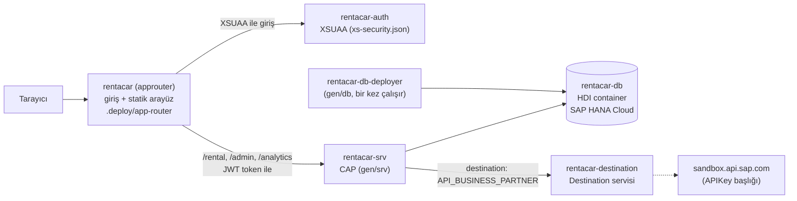

# SAP BTP'ye Deploy (SAP HANA Cloud)

Bu doküman uygulamayı SAP BTP Trial hesabına **senin** deploy etmen içindir. Proje deploy için hazır:
`cds build --production` ve `mbt build` hatasız çalışıyor, `mta_archives/rentacar_1.0.0.mtar` üretiliyor. Hiçbir
şey otomatik deploy edilmedi; aşağıdaki adımları sen uygularsın.

İçindekiler: [Mimari](#buluttaki-mimari) · [Ön koşullar](#ön-koşullar-windows-powershell) ·
[1. Trial hesabı](#1-sap-btp-trial-hesabı-ve-subaccount) · [2. HANA Cloud](#2-sap-hana-cloud-instanceı) ·
[3. Destination](#3-api_business_partner-destinationı) · [4. Build ve deploy](#4-build-ve-deploy) ·
[5. Rol koleksiyonları](#5-rol-koleksiyonlarını-kullanıcına-ata) · [6. Kontrol listesi](#6-deploy-sonrası-kontrol-listesi) ·
[Sık görülen hatalar](#sık-görülen-hatalar) · [Ek: HDI ve PostgreSQL](#ek-hana-hdi-artifactları-ve-postgresql-tabloları)

## Buluttaki mimari



| MTA modülü / kaynağı (`mta.yaml`) | Ne yapar |
|---|---|
| `rentacar` (approuter) | Kullanıcıyı SAP girişine yönlendirir, arayüz dosyalarını sunar, OData isteklerini token ile CAP'e iletir (`.deploy/app-router/xs-app.json`) |
| `rentacar-srv` | CAP Node.js servisi (`cds build`'in ürettiği `gen/srv`) |
| `rentacar-db-deployer` | HDI artifact'larını (`gen/db`) HANA'ya yükler, sonra durur |
| `rentacar-auth` | XSUAA: roller, rol koleksiyonları (`xs-security.json`) |
| `rentacar-db` | HDI container (HANA içinde uygulamaya ait izole şema) |
| `rentacar-destination` | Destination servisi: S/4 bağlantı bilgisi koddan ayrı tutulur |

Profil: bulutta `NODE_ENV=production` olduğu için `[production]` ayarları geçerli olur: veritabanı `hana`, kimlik
doğrulama `xsuaa`, S/4 bağlantısı `destination: API_BUSINESS_PARTNER` (`package.json` → `cds.requires`).

## Ön koşullar (Windows, PowerShell)

| Araç | Kurulum | Kontrol |
|---|---|---|
| Node.js 22+ | Zaten kurulu | `node -v` |
| Cloud MTA Build Tool | `npm install -g mbt` | `mbt --version` |
| GNU Make (mbt'nin ihtiyacı) | `choco install make` (Chocolatey) veya [GnuWin32 Make](https://gnuwin32.sourceforge.net/packages/make.htm) | `make --version` |
| Cloud Foundry CLI v8 | Windows installer: <https://github.com/cloudfoundry/cli/releases> | `cf version` |
| MultiApps eklentisi | `cf install-plugin multiapps` | `cf plugins` (`deploy` komutu görünmeli) |

## 1. SAP BTP Trial hesabı ve subaccount

1. <https://www.sap.com/products/technology-platform/trial.html> → **Start your free trial** → SAP hesabınla kayıt ol.
2. <https://account.hanatrial.ondemand.com> → **Go To Your Trial Account**. İlk girişte bölge (region) seçilir;
   **US East (VA) – AWS (us10)** öner. Kurulum birkaç dakika sürer ve şunları otomatik oluşturur:
   - Global account ve `trial` adında bir **subaccount**
   - Cloud Foundry **org** (`<kullanıcı-kodu>trial`) ve **space** (`dev`)
3. Subaccount'a gir → **Overview**: **API Endpoint** (ör. `https://api.cf.us10-001.hana.ondemand.com`) ve
   **Org Name** değerlerini not et.
4. **Entitlements** → listede şunlar olmalı; yoksa **Edit** → **Add Service Plans** ile ekle → **Save**:

   | Servis | Plan |
   |---|---|
   | SAP HANA Cloud | `tools`, `hana` |
   | SAP HANA Schemas & HDI Containers | `hdi-shared` |
   | Authorization and Trust Management Service | `application` |
   | Destination Service | `lite` |
   | Cloud Foundry Runtime | `MEMORY` (trial'da 4 GB) |

## 2. SAP HANA Cloud instance'ı

1. Subaccount → **Services** → **Service Marketplace** → **SAP HANA Cloud** → **Create** → Plan: **tools**
   (abonelik; HANA Cloud Central'ı açar) → **Create**.
2. **Security** → **Users** → kendi kullanıcın → **Assign Role Collection** → **SAP HANA Cloud Administrator**.
   Etkili olması için çıkış yapıp tekrar gir.
3. **Instances and Subscriptions** → **SAP HANA Cloud** satırı → **Go to Application** (HANA Cloud Central açılır).
4. **Create Instance** → **SAP HANA Cloud, SAP HANA Database**:
   - Instance name: `rentacar-hana`, **DBADMIN** şifresi belirle (bir yere not et, uygulama bu şifreyi kullanmaz).
   - Connections: **Allow all IP addresses** (trial için en kolayı) veya **Allow only BTP IP addresses**.
   - **Instance Mapping** (gelişmiş ayarlar adımında): **Add Mapping** → Environment Type: **Cloud Foundry**,
     Environment Instance ID: **Cloud Foundry org GUID**. Bunu şu komutla alırsın:
     ```powershell
     cf login -a https://api.cf.us10-001.hana.ondemand.com
     cf org <org-adın> --guid
     ```
     İstersen Environment Group'a space GUID'ini de yaz (`cf space dev --guid`); yazmazsan tüm space'ler kullanır.
   - **Create**. Oluşması 10–20 dakika sürer; durum **Running** olmalı.

> **Instance mapping neden gerekli?** HANA Cloud instance'ı subaccount düzeyinde oluşturuldu. Cloud Foundry'deki
> `hdi-shared` servisi bir HANA veritabanı arar; mapping, "bu org'un HDI container'ları bu veritabanında
> oluşturulsun" der. Mapping yoksa deploy "no HANA database found" benzeri bir hatayla durur.

> ⚠️ **Trial instance'ları her gece otomatik durdurulur.** Sabah uygulama "veritabanına bağlanılamıyor" hatası
> verir. Çözüm: HANA Cloud Central → `rentacar-hana` → **⋯ (Actions)** → **Start**. Başlaması birkaç dakika sürer;
> sonra `cf restart rentacar-srv`. Uzun süre hiç başlatılmayan trial instance'ları silinebilir; güncel trial
> koşullarını SAP'nin trial sayfasından kontrol et.

## 3. API_BUSINESS_PARTNER destination'ı

Uygulama S/4'ü `API_BUSINESS_PARTNER` adlı destination ile bulur. API anahtarı koda değil buraya girer.

1. Subaccount → **Connectivity** → **Destinations** → **Create** → **From Scratch**.
2. Alanlar:

   | Alan | Değer |
   |---|---|
   | Name | `API_BUSINESS_PARTNER` (büyük/küçük harf aynen) |
   | Type | `HTTP` |
   | URL | `https://sandbox.api.sap.com` |
   | Proxy Type | `Internet` |
   | Authentication | `NoAuthentication` |

3. **Additional Properties** → **New Property**: ad `URL.headers.APIKey`, değer **api.sap.com'daki yeni
   anahtarın**. (SAP Cloud SDK, `URL.headers.` ile başlayan özellikleri her isteğe HTTP başlığı olarak ekler.)
4. **Save**.

URL'nin geri kalanı (`/s4hanacloud/sap/opu/odata/sap/API_BUSINESS_PARTNER`) `package.json`'daki
`[production].credentials.path`'te. Gerçek bir S/4HANA'ya geçerken sadece destination değişir: URL müşterinin
sistemi, Authentication `BasicAuthentication` / `OAuth2SAMLBearerAssertion`, on-premise ise Proxy Type
`OnPremise` + Cloud Connector (bkz. [`s4-entegrasyonu.md`](s4-entegrasyonu.md#gerçek-projede-destination-ve-cloud-connector)).

## 4. Build ve deploy

Proje klasöründe:

```powershell
npm ci
mbt build                     # → mta_archives\rentacar_1.0.0.mtar (cds build --production + arayüz kopyalama dahil)
cf login -a https://api.cf.us10-001.hana.ondemand.com    # e-posta + şifre; org ve space (dev) seç
cf deploy mta_archives\rentacar_1.0.0.mtar
```

`cf deploy` 5–15 dakika sürer. Sırası: servisler oluşturulur (XSUAA, HDI container, Destination) →
`rentacar-db-deployer` tabloları ve örnek verileri HANA'ya yükler → `rentacar-srv` ve `rentacar` başlatılır. Sonunda
approuter adresi yazılır; sonradan görmek için:

```powershell
cf apps        # "rentacar" satırındaki route: https://<org>-dev-rentacar.cfapps.us10-001.hana.ondemand.com
```

`mbt build`'in yaptığı (`mta.yaml` → `before-all`): `npm ci`, `cds build --production` (`gen/srv`, `gen/db`),
`npm run build:ui` (`app/` altındaki Fiori uygulamalarını `.deploy/app-router/resources`'a kopyalar).

Kaldırmak (trial kaynaklarını boşaltmak) için: `cf undeploy rentacar --delete-services --delete-service-keys`.

## 5. Rol koleksiyonlarını kullanıcına ata

Deploy, `xs-security.json`'daki üç rol koleksiyonunu otomatik oluşturur:

| Rol koleksiyonu | Roller | Açılan uygulamalar |
|---|---|---|
| `RentACar_Agent` | RentalAgent | Kiralama Yönetimi, Müşteriler |
| `RentACar_Manager` | RentalAgent + RentalManager | + onay/red/indirim, Kiralama Analizi |
| `RentACar_FleetAdmin` | FleetAdmin | Filo Yönetimi |

1. Subaccount → **Security** → **Role Collections** → `RentACar_Manager` → **Edit**.
2. **Users** → kullanıcı kimliği olarak e-posta adresin, Identity Provider: **Default identity provider** → **Save**.
3. Tüm uygulamaları denemek için aynı şekilde `RentACar_FleetAdmin`'i de ata.
4. Rol değişikliği yeni girişte geçerli olur: approuter adresini **gizli pencerede** aç.

Lokaldeki `agent` / `manager` / `admin` kullanıcıları bulutta yoktur; bulutta herkes kendi SAP kullanıcısıyla girer ve
yetkisi rol koleksiyonundan gelir.

## 6. Deploy sonrası kontrol listesi

- [ ] `cf apps`: `rentacar` ve `rentacar-srv` **started**; `rentacar-db-deployer` **stopped** (normal: işi bitince durur).
- [ ] `cf services`: `rentacar-auth`, `rentacar-db`, `rentacar-destination` **create succeeded**.
- [ ] Approuter adresi → SAP giriş sayfası → launchpad'de dört kutucuk.
- [ ] Kiralama Yönetimi: örnek kiralamalar listeleniyor (veri HANA'dan).
- [ ] Yeni kiralama: oluştur → ek hizmet ekle → fiyat hesaplanıyor → kaydet → onayla → tamamla.
- [ ] Kiralama Analizi (Manager): grafik ve tablo dolu.
- [ ] Müşteriler → **S/4HANA'dan Getir**: sandbox'taki iş ortakları listeleniyor, biri içe aktarılabiliyor.
- [ ] `?sap-language=en` ile arayüz İngilizce.
- [ ] `cf logs rentacar-srv --recent`: hata yok; günlükte API anahtarı görünmüyor.

## Sık görülen hatalar

| Belirti | Sebep | Çözüm |
|---|---|---|
| `mbt build`: "make: command not found" / "exec: make" | GNU Make kurulu değil | `choco install make`, yeni PowerShell penceresi |
| `cf deploy`: "Service offering hana / plan hdi-shared not found" | Entitlement yok | Adım 1.4: "SAP HANA Schemas & HDI Containers – hdi-shared" ekle |
| `rentacar-db-deployer` hatası: veritabanı bulunamadı / bağlanılamadı | Instance mapping yok veya HANA durmuş | Adım 2.4 mapping; HANA Cloud Central → **Start**; `cf deploy` tekrar |
| Sabah uygulama açılıyor ama veri gelmiyor (500) | Trial HANA gece durdu | HANA Cloud Central → **Start**, sonra `cf restart rentacar-srv` |
| "Memory quota exceeded" / "insufficient resources" | Trial bellek kotası (4 GB) dolu | `cf apps` ile eski uygulamaları durdur/sil; `mta.yaml`'daki `memory` değerleri zaten 256 MB |
| Giriş sonrası "Bu işlem için yetkiniz yok" (403) | Rol koleksiyonu atanmamış veya eski token | Adım 5, sonra gizli pencerede tekrar gir |
| Giriş sırasında "redirect_uri has not been registered" | Approuter adresi XSUAA'da kayıtlı değil | `mta.yaml` → `rentacar-auth` → `redirect-uris`; route değiştiyse `cf deploy` tekrar |
| S/4'ten Getir: "S/4HANA bağlantısı yapılandırılmamış" | `API_BUSINESS_PARTNER` destination'ı yok veya adı farklı | Adım 3; ad birebir aynı olmalı |
| S/4'ten Getir: "S/4HANA erişimi reddedildi (401/403)" | `URL.headers.APIKey` yanlış/eksik veya anahtar yenilendi | Destination'daki özelliği kontrol et |
| Ekran boş | Kurumsal ağ `ui5.sap.com`'u engelliyor | Başka ağdan dene; kalıcı çözüm UI5'i HTML5 Application Repository ile dağıtmak |

Ayrıntılı hata için: `cf logs rentacar-srv --recent` ve `cf logs rentacar --recent` (approuter).

## Bu kurulumun sınırları

- **Launchpad sandbox**, üstünde "For Testing Purposes Only" yazan bir test aracıdır. Gerçek projede Fiori
  uygulamaları **HTML5 Application Repository**'ye yüklenir ve **SAP Build Work Zone** (gerçek launchpad) ile
  sunulur. Bu proje öğrenme amaçlı olduğu için arayüzü doğrudan approuter sunuyor.
- `db/data/*.csv` örnek verileri (uydurma kişiler dahil) HANA'ya da yüklenir. Gerçek bir sistemde bu dosyalar
  sadece geliştirme/test verisi olarak tutulur ve production build'e alınmaz.
- Tek instance, tek tenant (`tenant-mode: dedicated`); çok kiracılı (multitenant) yapı yok.

## Ek: HANA HDI artifact'ları ve PostgreSQL tabloları

Aynı CDS modeli iki veritabanına farklı yollarla gider:

```powershell
npx cds build --production    # → gen/db/src/gen/*.hdbtable, *.hdbview, *.hdbindex, data/*.hdbtabledata
npm run db:deploy             # → PostgreSQL'e doğrudan CREATE TABLE / CREATE VIEW
```

**`rentacar.Rentals` tablosu.** HANA (`gen/db/src/gen/rentacar.Rentals.hdbtable`):

```sql
COLUMN TABLE rentacar_Rentals (
  ID NVARCHAR(36) NOT NULL,
  rentalID INTEGER,
  pickupDate DATE,
  totalPrice DECIMAL(10, 2),
  currency_code NVARCHAR(3) DEFAULT 'TRY',
  notes NCLOB,
  ...
  PRIMARY KEY(ID)
)
```

PostgreSQL (`\d rentacar_rentals`):

```text
 id            | character varying(36) | not null
 rentalid      | integer               |
 pickupdate    | date                  |
 totalprice    | numeric(10,2)         |
 currency_code | character varying(3)  | default 'TRY'
 notes         | text                  |
Indexes: "rentacar_rentals_pkey" PRIMARY KEY, "rentacar_rentals_rentalid" UNIQUE CONSTRAINT
```

| Konu | SAP HANA Cloud (HDI) | PostgreSQL (`cds deploy`) |
|---|---|---|
| Nasıl oluşur | Her nesne ayrı bir **dosya** (artifact): `.hdbtable`, `.hdbview`, `.hdbindex`. HDI deployer bunları bir **container**'a yükler | `cds deploy` tek seferde SQL DDL çalıştırır |
| Bu projede | 24 `.hdbtable`, 64 `.hdbview`, 2 `.hdbindex`, 19 `.hdbtabledata` | Aynı 24 tablo + `cds_model` (son kurulan model) + S/4 mock'ları için 36 tablo (`--with-mocks`), 65 view |
| Tablo türü | `COLUMN TABLE`: kolon bazlı depolama, bellekte (in-memory); analitik toplamalar hızlı | Satır bazlı (row store), diskte; sorgu için indeks gerekir |
| Metin tipleri | `NVARCHAR` (Unicode), `NCLOB` | `varchar`, `text` |
| Ondalık | `DECIMAL(10,2)` | `numeric(10,2)` |
| Benzersizlik (`@assert.unique`) | Ayrı dosya: `UNIQUE INVERTED INDEX` (`rentacar.Rentals.rentalID.hdbindex`) | Tabloya `UNIQUE CONSTRAINT` |
| Örnek veri (CSV) | `.hdbtabledata` + CSV: HDI deployer yükler | `cds deploy` `INSERT` ile yükler |
| İsimler | Büyük harf: `RENTACAR_RENTALS` (tırnaksız isimler büyük harfe çevrilir) | Küçük harf: `rentacar_rentals` |
| Şema | Her uygulamaya izole **HDI container** (kendi şeması ve teknik kullanıcıları); uygulama başka şemaya erişemez | `public` şeması; bağlantı kullanıcısı her şeye erişir |
| Çeviri view'ları | `localized_...` view'ı `SESSION_CONTEXT('LOCALE')` ile dil seçer | Aynı view `current_setting('cap.locale')` ile seçer |
| Model değişince | HDI eski ve yeni dosyaları karşılaştırır; tabloyu **veriyi koruyarak** değiştirir (migration). Silinen nesneler `undeploy.json` ile kaldırılır | `@cap-js/postgres` şema evrimi (`schema_evolution: auto`): son kurulan model `cds_model` tablosunda saklanır, `cds deploy` sadece farkı uygular (`ALTER TABLE`), veri korunur; CSV satırları yeniden yazılır |
| Taslak (draft) tabloları | `RentalService.Rentals_drafts.hdbtable` vb.; `undeploy.json` sayesinde model değişince yeniden oluşturulabilir | `rentalservice_rentals_drafts` tablosu |

Sonuç: Kod ve CDS modeli iki veritabanında aynıdır; fark sadece CAP'in ürettiği veritabanı nesnelerinin biçimindedir.
Bu yüzden lokalde PostgreSQL ile geliştirip bulutta HANA kullanmak mümkündür. Tek şart, CDS'in taşınabilir
özelliklerinde kalmaktır: veritabanına özgü SQL fonksiyonları yerine `year()`, `substring()` gibi CDS
fonksiyonları. Model her değişiklikte iki hedefe de derlenerek kontrol edilir:
`cds compile db --to sql --dialect postgres` ve `cds compile db --to hana`.
