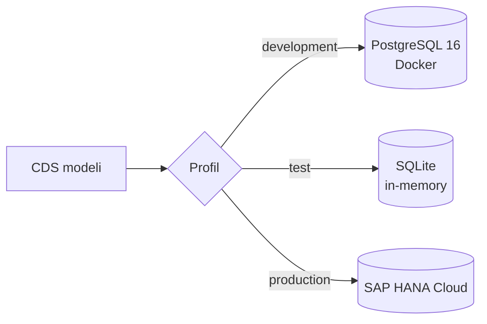
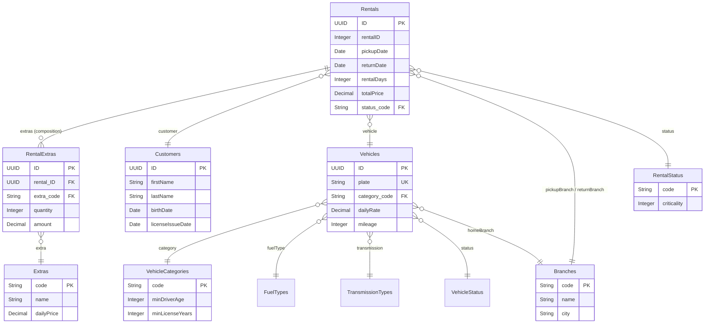
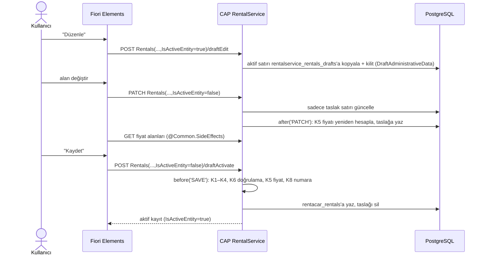

# Mimari

> Bu doküman her aşamada güncellenir.

## Katmanlar

| Katman | Klasör | İçerik |
|---|---|---|
| Arayüz (UI) | `app/` | SAP Fiori Elements (OData V4) uygulamaları |
| Servis | `srv/` | CDS servis tanımları + JavaScript handler'ları (iş kuralları) |
| Veri modeli | `db/` | CDS entity'leri, kod listeleri, örnek CSV verileri |
| Veritabanı | — | PostgreSQL (lokal), SQLite (test), SAP HANA Cloud (production) |

## Veritabanı seçimi (profiller)

Aynı CDS modeli, profil hangi veritabanını seçerse onun SQL diline (dialect) derlenir. Kod değişmez.

## Veri modeli

`db/schema.cds` işlem verilerini (kiralama), `db/master-data.cds` ana verileri ve kod listelerini, `db/labels.cds`
alan etiketlerini içerir.

Kod listeleri (`VehicleCategories`, `FuelTypes`, `TransmissionTypes`, `VehicleStatus`, `RentalStatus`) ve `Extras`
çok dillidir: her biri için bir `_texts` tablosu ve bir `localized_` view'ı oluşur.

## Servisler

| Servis | Yol | Entity'ler | Not |
|---|---|---|---|
| `RentalService` | `/rental` | `Rentals` (draft), `RentalExtras`, `Customers`; salt okunur: `Vehicles`, `Branches`, `Extras`, kod listeleri | Şube çalışanı ve yönetici |
| `AdminService` | `/admin` | `Vehicles` (draft), `Branches`, `Extras`, `VehicleCategories`; salt okunur: diğer kod listeleri | Filo yöneticisi |

## İstek akışı

Fiori'de bir kiralamayı düzenleyip kaydetmek (draft akışı):

## İş mantığı dosyaları

| Dosya | İçerik |
|---|---|
| `srv/rental-service.js` | K1–K8 kuralları ve 5 action (her kural ayrı fonksiyon); `calculatePrice` saf fonksiyon olarak dışa aktarılır |
| `srv/field-control.cds` | `@UI.UpdateHidden` (K7), `@Common.SideEffects` (K5), `@Core.OperationAvailable` (action butonları) |
| `_i18n/messages*.properties` | Hata ve bilgi mesajları (EN/TR) |
