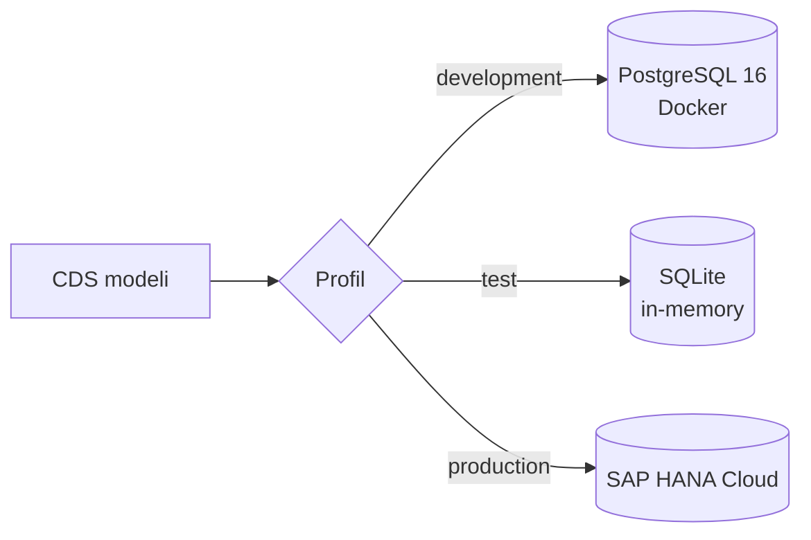

# Mimari

> Bu doküman her aşamada güncellenir. Veri modeli diyagramı Aşama 1'de, istek akışı Aşama 2–3'te eklenecek.

## Katmanlar

| Katman | Klasör | İçerik |
|---|---|---|
| Arayüz (UI) | `app/` | SAP Fiori Elements (OData V4) uygulamaları |
| Servis | `srv/` | CDS servis tanımları + JavaScript handler'ları (iş kuralları) |
| Veri modeli | `db/` | CDS entity'leri, kod listeleri, örnek CSV verileri |
| Veritabanı | — | PostgreSQL (lokal), SQLite (test), SAP HANA Cloud (production) |

## Veritabanı seçimi (profiller)

Aynı CDS modeli, profil hangi veritabanını seçerse onun SQL diline (dialect) derlenir. Kod değişmez.
