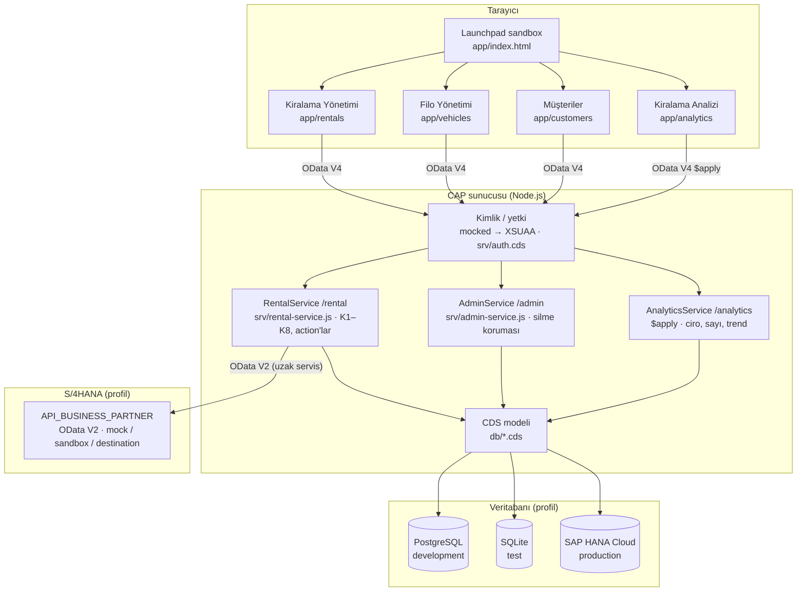
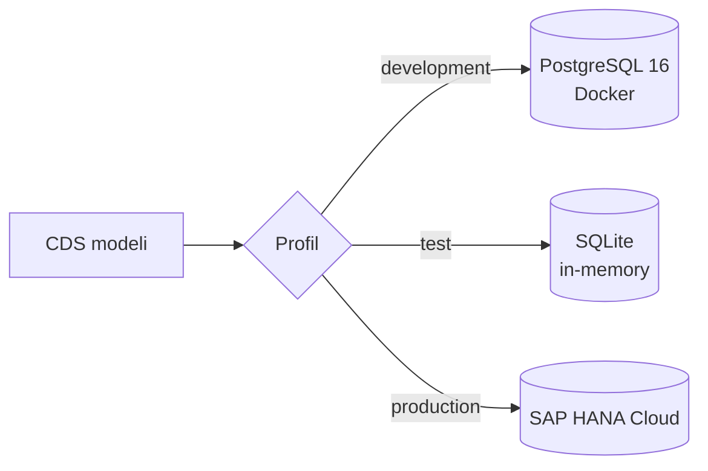
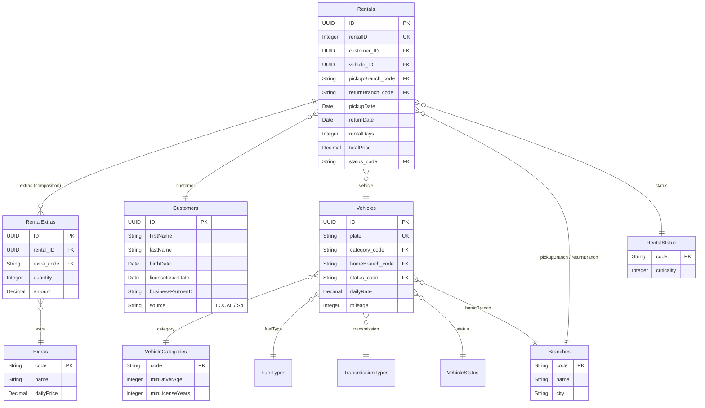
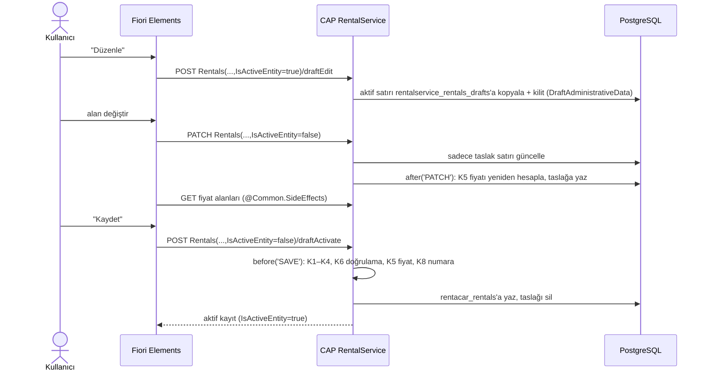
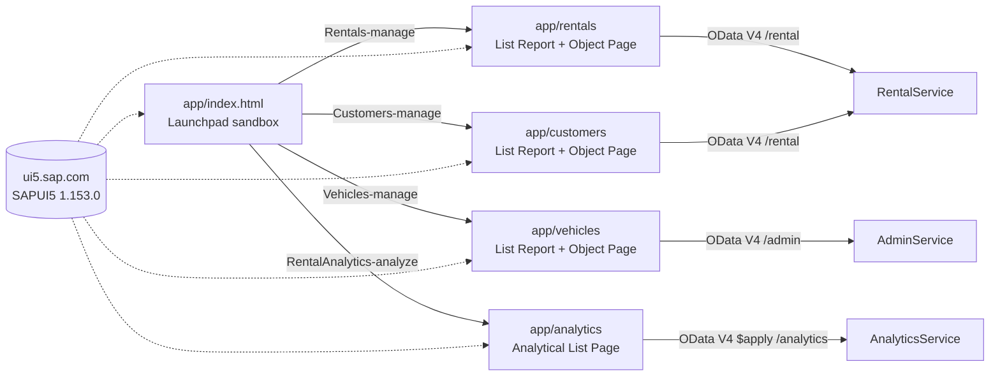
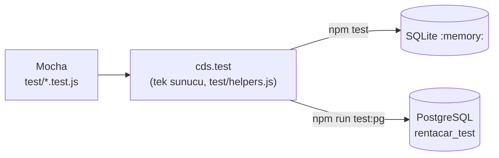

# Mimari

RentACar, SAP CAP (Node.js) üzerinde katmanlı bir uygulamadır: Fiori Elements arayüzü OData V4 ile CAP servislerine
bağlanır; servisler iş kurallarını uygular ve veriyi profil ile seçilen veritabanında tutar.

İçindekiler: [Genel bakış](#genel-bakış) · [Katmanlar](#katmanlar) · [Veritabanı seçimi](#veritabanı-seçimi-profiller) ·
[Veri modeli](#veri-modeli) · [Servisler](#servisler) · [İstek akışı](#istek-akışı) ·
[İş mantığı dosyaları](#iş-mantığı-dosyaları) · [Yetkilendirme](#yetkilendirme) · [Arayüz](#arayüz) · [Testler](#testler) ·
S/4HANA entegrasyonu: [ayrı doküman](s4-entegrasyonu.md)

## Genel bakış

## Katmanlar

| Katman | Klasör | İçerik |
|---|---|---|
| Arayüz (UI) | `app/` | Fiori Elements (OData V4): `app/rentals` (Kiralama Yönetimi), `app/vehicles` (Filo Yönetimi), `app/customers` (Müşteriler, S/4'ten içe aktarma), `app/analytics` (Kiralama Analizi, ALP), `app/index.html` (launchpad sandbox) |
| Servis | `srv/` | CDS servis tanımları, yetkiler (`auth.cds`), JavaScript handler'ları (iş kuralları) |
| Uzak servis | `srv/external/` | S/4HANA Business Partner API'sinin içe aktarılmış modeli (`cds import`) ve mock verileri |
| Veri modeli | `db/` | CDS entity'leri, kod listeleri, örnek CSV verileri |
| Veritabanı | — | PostgreSQL (lokal), SQLite (test), SAP HANA Cloud (production) |

## Veritabanı seçimi (profiller)

Aynı CDS modeli, profil hangi veritabanını seçerse onun SQL diline (dialect) derlenir. Kod değişmez.

| Profil | Veritabanı | Kimlik doğrulama | S/4HANA |
|---|---|---|---|
| `development` | PostgreSQL | mocked (agent/manager/admin) | mock |
| `test` | SQLite `:memory:` | mocked | mock |
| `development` + `sandbox` | PostgreSQL | mocked | SAP sandbox (`APIKey`) |
| `production` (BTP) | SAP HANA Cloud (HDI) | XSUAA | Destination `API_BUSINESS_PARTNER` |

Buluttaki yapı (approuter, XSUAA, HDI container, Destination servisi) ve deploy adımları: [`deploy.md`](deploy.md).

## Veri modeli

`db/schema.cds` işlem verilerini (kiralama), `db/master-data.cds` ana verileri ve kod listelerini, `db/labels.cds`
alan etiketlerini içerir.

Kod listeleri (`VehicleCategories`, `FuelTypes`, `TransmissionTypes`, `VehicleStatus`, `RentalStatus`) ve `Extras`
çok dillidir: her biri için bir `_texts` tablosu ve bir `localized_` view'ı oluşur.

## Servisler

| Servis | Yol | Entity'ler | Not |
|---|---|---|---|
| `RentalService` | `/rental` | `Rentals` (draft), `RentalExtras`, `Customers`; salt okunur: `Vehicles`, `Branches`, `Extras`, kod listeleri, `S4BusinessPartners` (uzak); action `importFromS4` | Şube çalışanı ve yönetici |
| `AnalyticsService` | `/analytics` | `RentalAnalytics` (salt okunur, `$apply` ile toplanır: şube/kategori/ay boyutları; ciro, kiralama sayısı, gün ölçüleri); value help için `Branches`, `VehicleCategories`, `RentalStatus` | Sadece yönetici; sadece onaylanmış ve tamamlanmış kiralamalar |
| `AdminService` | `/admin` | `Vehicles` (draft), `Branches`, `Extras`, `VehicleCategories`; salt okunur: diğer kod listeleri | Filo yöneticisi |

## İstek akışı

Fiori'de bir kiralamayı düzenleyip kaydetmek (draft akışı):

## İş mantığı dosyaları

| Dosya | İçerik |
|---|---|
| `srv/rental-service.js` | K1–K8 kuralları ve 5 action (her kural ayrı fonksiyon); `calculatePrice` saf fonksiyon olarak dışa aktarılır; S/4 okuma (`S4BusinessPartners`), `importFromS4` ve bağlantı hatası sınıflandırma (`classifyS4Error`) |
| `srv/analytics-service.js` | Sıralama istenmemiş gruplu analitik sorguları gruplama alanlarına göre sıralar (aylık trend sırası) |
| `srv/admin-service.js` | Kiralamalarda kullanılan araç, şube veya ek hizmetin silinmesini engeller (409 `*_IN_USE`) |
| `srv/field-control.cds` | `@UI.UpdateHidden` (K7), `@UI.DeleteHidden`, `@Common.SideEffects` (K5, action'lar), `@Core.OperationAvailable` (action butonları + `canManage`) |
| `_i18n/messages*.properties` | Hata ve bilgi mesajları (EN/TR) |

## Yetkilendirme

`srv/auth.cds`:

| İşlem | RentalAgent | RentalManager (+ Agent) | FleetAdmin |
|---|---|---|---|
| RentalService okuma | ✅ | ✅ | ❌ 403 |
| Kiralama oluşturma / düzenleme (draft) | ✅ | ✅ | ❌ |
| Kaydedilmiş kiralamayı silme | ❌ 403 | ❌ 403 | ❌ |
| `complete`, `cancel` | ✅ | ✅ | ❌ |
| `approve`, `reject`, `applyDiscount` | ❌ 403 | ✅ | ❌ |
| Müşteri ekleme / düzenleme | ✅ | ✅ | ❌ |
| S/4 iş ortaklarını okuma, `importFromS4` | ✅ | ✅ | ❌ 403 |
| AnalyticsService (ciro analizi) | ❌ 403 | ✅ | ❌ 403 |
| AdminService (araç, şube, ek hizmet) | ❌ 403 | ❌ 403 | ✅ |
| Giriş yapılmamış | 401 | 401 | 401 |

## Arayüz

| Uygulama | Kullanıcı | Servis | Anotasyonlar |
|---|---|---|---|
| Kiralama Yönetimi | agent, manager | `/rental` | `app/rentals/annotations.cds`, `app/common.cds`, `srv/field-control.cds` |
| Filo Yönetimi | admin | `/admin` | `app/vehicles/annotations.cds`, `app/common.cds` |
| Müşteriler | agent, manager | `/rental` | `app/customers/annotations.cds` (S/4'ten Getir butonu, iş ortağı value help) |
| Kiralama Analizi | manager | `/analytics` | `app/analytics/annotations.cds` (`UI.Chart`, analitik tablo); toplama anotasyonları `srv/analytics-service.cds` |

## Testler

| Test dosyası | Kapsam |
|---|---|
| `test/pricing.test.js` | K5 formülü (birim testi) |
| `test/rental-rules.test.js` | Draft akışı, K1–K8, taslakta anlık fiyat |
| `test/rental-actions.test.js` | 5 action |
| `test/auth.test.js` | 401/403, rol bazlı izinler |
| `test/admin.test.js` | Ana veri silme koruması |
| `test/analytics.test.js` | `$apply` toplamları (şube, kategori, ay), sadece A/C, yetki |
| `test/s4-integration.test.js` | S/4 okuma, sayfalama, arama, içe aktarma, hata sınıflandırma (mock modu, internet gerekmez) |

