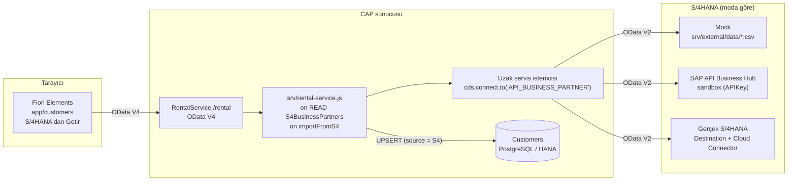
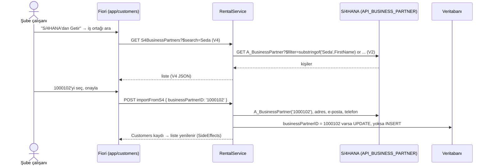
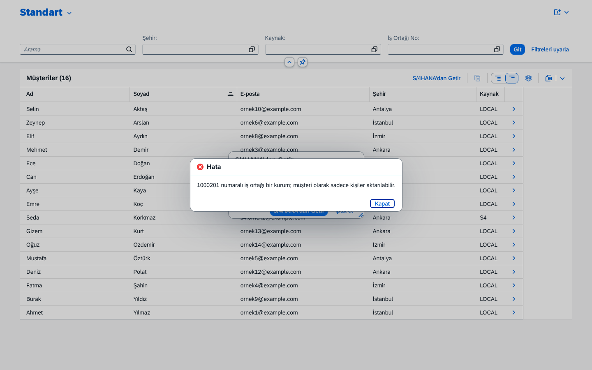
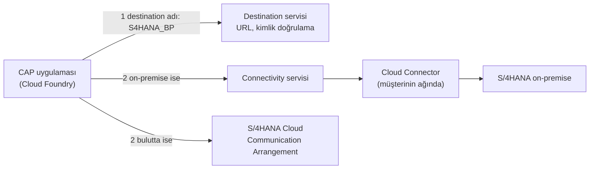

# S/4HANA Business Partner Entegrasyonu

Müşteri verisi bir S/4HANA sisteminde de tutuluyorsa, şube çalışanı aynı kişiyi elle tekrar girmek yerine S/4'ten
**içe aktarır**. Uygulama S/4HANA'nın standart **Business Partner API**'sini (`API_BUSINESS_PARTNER`, OData V2)
tüketir: iş ortaklarını listeler (value help) ve seçileni yerel `Customers` tablosuna kopyalar.

Bu bir **side-by-side extension**'dır: RentACar kendi veritabanında çalışır, S/4'e sadece API ile bağlanır,
S/4'ün içine kod yazmaz.

İçindekiler: [Mimari](#mimari) · [Dosyalar](#dosyalar) · [Üç çalışma modu](#üç-çalışma-modu) ·
[Sandbox ile denemek](#sandbox-ile-denemek-powershell) · [V2 servisi V4 olarak yayınlamak](#v2-servisi-v4-olarak-yayınlamak) ·
[Hata yönetimi](#hata-yönetimi) · [Gerçek projede: Destination ve Cloud Connector](#gerçek-projede-destination-ve-cloud-connector) ·
[EDMX dosyası](#edmx-dosyası-ve-kendi-indirdiğinle-değiştirmek) · [Tuzaklar](#karşılaşılan-tuzaklar)

| S/4'ten Getir: iş ortağı value help | İçe aktarılan müşteri (Kaynak = S4) |
|---|---|
|  |  |

## Mimari



İçe aktarma akışı:



## Dosyalar

| Dosya | Görevi |
|---|---|
| `srv/external/API_BUSINESS_PARTNER.edmx` | S/4'ün servis tanımı (metadata), `cds import`'un girdisi |
| `srv/external/API_BUSINESS_PARTNER.csn` | `cds import`'un ürettiği CDS modeli; CAP bunu okur |
| `srv/external/data/*.csv` | Mock modundaki sahte iş ortakları: 10 kişi (1000101–1000110), 2 kurum (1000201–1000202) |
| `package.json` → `cds.requires.API_BUSINESS_PARTNER` | Uzak servisin türü (`odata-v2`), modeli ve moda göre bağlantı bilgisi |
| `srv/rental-service.cds` | `S4BusinessPartners` projeksiyonu ve `importFromS4` action'ı |
| `srv/rental-service.js` | Okuma yönlendirme, arama çevirisi, içe aktarma, hata sınıflandırma (`classifyS4Error`) |
| `db/master-data.cds` | `Customers.businessPartnerID` ve `Customers.source` (`LOCAL` / `S4`) |
| `app/customers/` | Müşteriler uygulaması, "S/4HANA'dan Getir" butonu ve iş ortağı value help'i |
| `test/s4-integration.test.js` | Mock modunda 17 test (internet ve anahtar gerekmez) |

## Üç çalışma modu

Kod hiç değişmez. CAP, `cds.requires.API_BUSINESS_PARTNER` altında **bağlantı bilgisi (credentials) var mı**
ona bakar:

| Mod | Nasıl seçilir | Bağlantı | Ne zaman |
|---|---|---|---|
| **Mock** (varsayılan) | `npm run watch`, `npm test`. Credentials yok ve `--with-mocks` açık → CAP servisi yerelde taklit eder | `srv/external/data/*.csv` (geliştirmede PostgreSQL tablosu, testte SQLite) | Günlük geliştirme, testler, internet yokken |
| **Sandbox** | `npm run sandbox` (`cds serve all --profile sandbox`) + `.env`'de `BP_API_KEY` | `https://sandbox.api.sap.com/s4hanacloud/sap/opu/odata/sap/API_BUSINESS_PARTNER`, her istekte `APIKey` başlığı | Gerçek S/4 verisiyle (SAP'nin demo verisi) denemek; salt okunur |
| **Production** | `[production]` profili, BTP'de ([`deploy.md`](deploy.md#3-api_business_partner-destinationı)) | BTP Destination servisindeki `API_BUSINESS_PARTNER` destination'ı → (gerekirse) Cloud Connector → S/4 sistemi | Canlı kullanım |

```jsonc
// package.json (özet)
"API_BUSINESS_PARTNER": {
  "kind": "odata-v2",
  "model": "srv/external/API_BUSINESS_PARTNER",
  "[sandbox]": {
    "credentials": {
      "url": "https://sandbox.api.sap.com/s4hanacloud/sap/opu/odata/sap/API_BUSINESS_PARTNER",
      "requestTimeout": 10000
    }
  },
  "[production]": {
    "credentials": {
      "destination": "API_BUSINESS_PARTNER",
      "path": "/s4hanacloud/sap/opu/odata/sap/API_BUSINESS_PARTNER",
      "requestTimeout": 10000
    }
  }
}
```

API anahtarı yapılandırmaya yazılmaz. `srv/rental-service.js` sunucu başlarken `process.env.BP_API_KEY`'i okur ve
sadece **bir URL tanımlıysa** (sandbox) `credentials.headers.APIKey` olarak ekler. CAP `.env` dosyasını
development profili aktifken `process.env`'e yükler. Bağlantı günlüğünde anahtar `APIKey: '...'` olarak
maskelenir (CAP, adında *key*, *secret*, *password* geçen alanları gizler).

> **Neden `cds watch --profile sandbox` değil?** `cds watch`, `--with-mocks` ile başlar ve yerel bağlantı
> kayıt dosyasına (`~/.cds-services.json`) bakar. Aynı anda başka bir `cds watch` çalışıyorsa sandbox sunucusu
> onun mock'una bağlanır (`localhost:4004/odata/v4/api-business-partner`). `cds serve` bu kayda bakmaz;
> denendi ve doğrulandı.

## Sandbox ile denemek (PowerShell)

1. <https://api.sap.com> → giriş yap → sağ üstteki profil menüsünden **Settings** → **Show API Key**. Anahtarı kopyala.
2. Proje klasöründeki `.env` dosyasına ekle (bu dosya `.gitignore`'da, commit'lenmez):
   ```powershell
   Add-Content .env "BP_API_KEY=<anahtarın>"
   ```
3. Mock sunucusu açıksa kapat (Ctrl+C), sonra:
   ```powershell
   npm run db:up
   npm run sandbox
   ```
4. <http://localhost:4004/customers/webapp/index.html?sap-language=tr> → **S/4HANA'dan Getir** → değer listesi
   artık SAP'nin sandbox sistemindeki iş ortaklarını gösterir.

> ⚠️ Anahtarı `.env.example`'a, koda veya GitHub web arayüzüyle repoya **yükleme**. `.gitignore` sadece `git add`'i
> engeller; GitHub'da "Add file → Create new file" ile oluşturulan `.env` doğrudan repoya girer. Anahtar bir kez
> açık bir repoya girdiyse commit'i silmek yetmez: api.sap.com'da anahtarı yenile.

Sandbox salt okunurdur (sadece GET). İçe aktarma sadece yerel veritabanına yazar, S/4'e bir şey göndermez.
Sandbox'taki iş ortaklarının çoğunun adresi, e-postası veya telefonu boş olabilir; bu durumda o alanlar boş kalır.

## V2 servisi V4 olarak yayınlamak

S/4HANA'nın Business Partner API'si **OData V2**, Fiori Elements V4 uygulamamız ise **OData V4** konuşur. CAP
aradaki çeviriyi yapar: `S4BusinessPartners`, uzak entity'nin bir **projeksiyonu**dur ve `RentalService` içinde
normal bir V4 entity'si gibi yayınlanır.

```cds
// srv/rental-service.cds
using {API_BUSINESS_PARTNER as bp} from './external/API_BUSINESS_PARTNER';

@readonly
entity S4BusinessPartners as projection on bp.A_BusinessPartner {
  key BusinessPartner as ID, FirstName as firstName, LastName as lastName,
      BusinessPartnerFullName as fullName, BirthDate as birthDate,
      @UI.Hidden BusinessPartnerCategory as category
};
```

Uzak entity'nin verisi bizim veritabanımızda değildir. Bu yüzden `on('READ')` handler'ı sorguyu uzak servise
iletir: `bupa.run(req.query)`. CAP, V4 sorgusunu (CQN) V2 URL'ine çevirir. Sandbox'a giden gerçek bir istek:

| Fiori'nin V4 isteği | CAP'in S/4'e gönderdiği V2 isteği |
|---|---|
| `GET /rental/S4BusinessPartners` | `GET /A_BusinessPartner` |
| `$select=ID,fullName` | `$select=BusinessPartner,BusinessPartnerFullName` (alan adları geri çevrilir) |
| `$search=Seda` | V2'de `$search` yok. Handler bunu `contains(...)` filtresine çevirir → `$filter=substringof('Seda',FirstName) or ...` |
| (handler ekler) `where category = '1'` | `and BusinessPartnerCategory eq '1'` (sadece kişiler) |
| `$top=5&$skip=10` | `$top=5&$skip=10` |
| `$count=true` | `$inlinecount=allpages` |

Yanıtta da çeviri vardır: V2 tarih biçimi `/Date(749606400000)/` → `1993-10-03`; V2 sayımı `"__count": "2"`
(metin) → handler'da sayıya çevrilir (`@odata.count: 2`).

## Hata yönetimi

S/4'e ulaşılamaması uygulamayı çökertmemeli; kullanıcı ne olduğunu anlamalı. CAP uzak servis hatalarını 502 ile
sarar; `classifyS4Error` gerçek sebebi bulup i18n mesaj anahtarına çevirir. CAP production'da 5xx mesajlarını
genel bir metinle ("Bad Gateway") değiştirir; bu mesajlar kullanıcıya yönelik olduğu için `$sanitize: false` ile
olduğu gibi gösterilir:

| Durum | Ne olur | Kullanıcıya | Doğrulama |
|---|---|---|---|
| Yanlış/eksik API anahtarı, yetkisiz destination | S/4 401/403 döner | 502 `S4_UNAUTHORIZED`: "S/4HANA erişimi reddedildi (401/403)..." | Sahte sandbox sunucusu + yanlış anahtar |
| S/4 yavaş (`requestTimeout` aşıldı) | Yanıt yok | 504 `S4_UNREACHABLE`: "S/4HANA sistemine şu anda ulaşılamıyor..." | 15 sn bekleyen sahte sunucu, 3 sn zaman aşımı |
| Sunucu kapalı / DNS hatası (`ECONNREFUSED`, `ENOTFOUND`) | Bağlantı kurulamaz | 504 `S4_UNREACHABLE` | Kapalı port, engelli alan adı |
| BTP'de destination yok veya adı yanlış | Bağlantı kurulmadan hata | 502 `S4_NOT_CONFIGURED`: "S/4HANA bağlantısı yapılandırılmamış..." | `NODE_ENV=production` ile yerel duman testi + birim testi |
| S/4 başka bir hata döner (500 vb.) | — | 502 `S4_ERROR`: "...(durum 500)" | Birim testi |
| İş ortağı yok | — | 404 `S4_BP_NOT_FOUND` | Mock testi |
| İş ortağı bir kurum | — | 400 `S4_BP_NOT_PERSON` | Mock testi + ekran |



## Gerçek projede: Destination ve Cloud Connector

Sandbox'taki gibi URL ve anahtarı yapılandırmaya yazmak sadece deneme içindir. BTP'de çalışan gerçek bir projede:



- **Destination servisi (BTP):** Hedef sistemin URL'ini ve kimlik bilgilerini (Basic, OAuth2SAMLBearer,
  ClientCertificate...) kodun dışında, BTP cockpit'te tutar. Uygulama sadece adını bilir:
  `"credentials": { "destination": "API_BUSINESS_PARTNER", "path": "..." }`. Sandbox için destination'a API anahtarı
  `URL.headers.APIKey` özelliğiyle eklenir ([`deploy.md`](deploy.md#3-api_business_partner-destinationı)).
  Şifre değişince uygulama yeniden deploy edilmez.
- **Cloud Connector:** Müşterinin şirket ağına kurulan küçük bir ajan. Buluttan içeri port açmadan, içeriden
  dışarıya güvenli tünel kurar. On-premise S/4 için gerekir; destination'da `ProxyType: OnPremise` yazılır.
- **S/4HANA Cloud:** Cloud Connector gerekmez. S/4 tarafında **Communication Arrangement** (senaryo
  `SAP_COM_0008`, Business Partner) ve bir communication user oluşturulur; destination bu kullanıcıyla bağlanır.
- **Kullanıcı yetkisinin taşınması (principal propagation):** Teknik kullanıcı yerine, uygulamaya giren
  kullanıcının kimliğiyle S/4'e bağlanmak. Böylece S/4'teki yetkiler de uygulanır.
- CAP tarafında `@sap-cloud-sdk/connectivity` bu çözümlemeyi yapar. `mta.yaml`'da `rentacar-destination` servisi
  bağlıdır; on-premise bir S/4 için ayrıca `connectivity` servisi eklenir (`cds add connectivity`).
- Destination bulunamazsa kullanıcı `S4_NOT_CONFIGURED` mesajını görür ("S/4HANA bağlantısı yapılandırılmamış").

## EDMX dosyası ve kendi indirdiğinle değiştirmek

`srv/external/API_BUSINESS_PARTNER.edmx`, SAP'nin açık kaynak örneği
[SAP-samples/cloud-cap-risk-management](https://github.com/SAP-samples/cloud-cap-risk-management) (Apache 2.0
lisansı) deposundan alındı. Bu, SAP'nin yayınladığı API'nin kısaltılmamış metadata'sıdır. Kendi indirdiğin sürümle
değiştirmek için:

1. <https://api.sap.com/api/API_BUSINESS_PARTNER/overview> → **API Specification** → **EDMX** indir.
2. ```powershell
   Copy-Item $HOME\Downloads\API_BUSINESS_PARTNER.edmx srv\external\
   npx cds import srv\external\API_BUSINESS_PARTNER.edmx --force
   ```
   `cds import` `.csn` dosyasını yeniden üretir ve `package.json`'daki `cds.requires.API_BUSINESS_PARTNER` kaydını
   günceller. Sonrasında `git diff package.json` ile `[sandbox]` bölümünün yerinde durduğunu kontrol et.
3. `npm test` ile doğrula.

## Karşılaşılan tuzaklar

1. **Projeksiyondaki `where` uzak servise gitmez.** `as projection on bp.A_BusinessPartner where
   BusinessPartnerCategory = '1'` yazıldığında mock'ta kurumlar da listelendi. Çözüm: filtre handler'da
   `req.query.where({ category: '1' })` ile eklenir.
2. **V2'de `$search` yoktur.** CAP `$search`'i V2'ye standart dışı `search=` parametresi olarak yazar; S/4'ün bunu
   desteklemesi garanti değildir. Çözüm: handler aramayı `contains()` filtresine çevirir. Dikkat:
   `delete query.SELECT.search` yetmedi, çünkü sorgu nesnesi prototip zinciriyle türetilmiş;
   `query.SELECT.search = undefined` gerekti.
3. **Ağ hatasının kodu her zaman alanda değil.** `ENOTFOUND` bazen sadece mesaj metninde geçiyor ("fetch failed
   Caused by: getaddrinfo ENOTFOUND"). `classifyS4Error` hem alana hem metne bakar.
4. **Büyük harfli servis adı ortam değişkeniyle ezilemez.** `CDS_REQUIRES_API__BUSINESS__PARTNER_CREDENTIALS_URL`
   çalışmaz, çünkü CAP tamamı büyük harf olan anahtarı küçültür (`api_business_partner`). Yapılandırmayı dışarıdan
   değiştirmek için `CDS_CONFIG='{"requires":{"API_BUSINESS_PARTNER":{...}}}'` (JSON) kullanılır.
5. **İçe aktarılan EDMX'teki gezinme ilişkileri koşulsuz.** `to_BusinessPartnerAddress` gibi ilişkilerin `on`
   koşulu yok, bu yüzden `$expand` yerine adres, e-posta ve telefon anahtarla ayrı ayrı okunur.
6. **Bağımsız (unbound) action sonrası liste yenilenmez.** Fiori hangi kaydın değiştiğini bilemez. Çözüm:
   `@Common.SideEffects: { TargetEntities: ['/RentalService.EntityContainer/Customers'] }`.
7. **`cds.test` uzak servisi kendiliğinden taklit etmez.** `cds watch` `--with-mocks` ekler, `cds.test` eklemez:
   "No credentials configured" hatası. Çözüm: `cds.test('serve', 'all', '--with-mocks', '--in-memory?')`.
